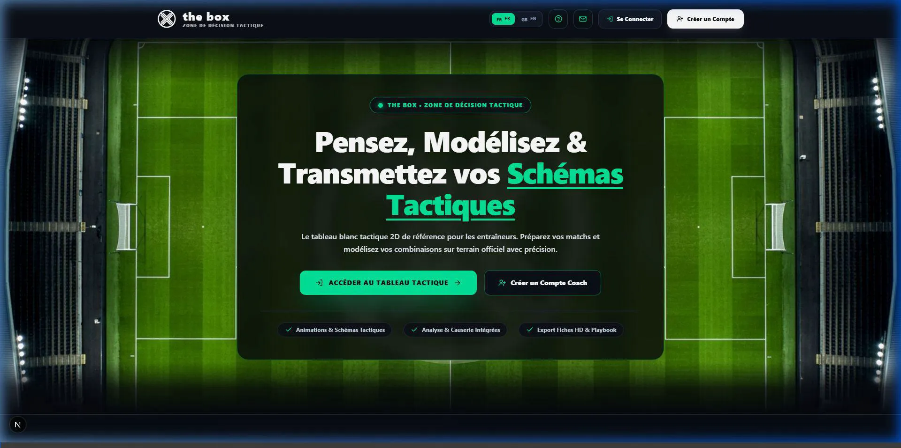
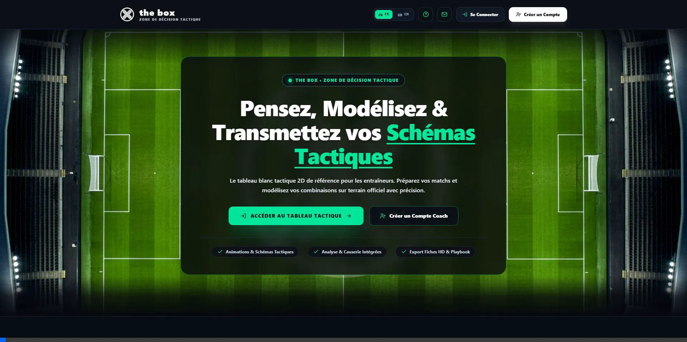
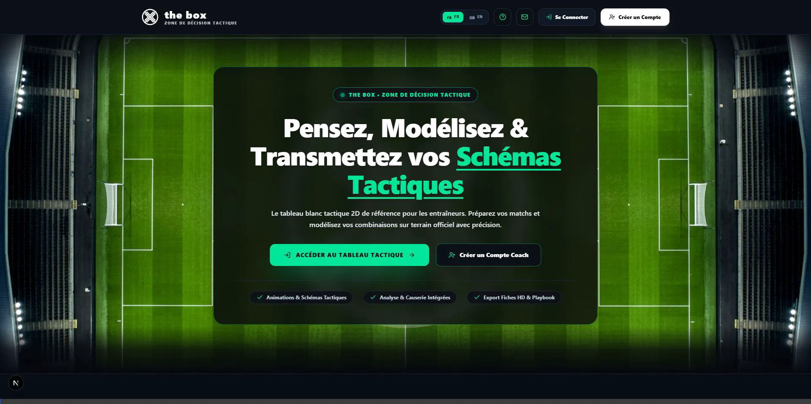

# 📖 Guide Utilisateur - TheBox

Bienvenue sur le guide d'utilisation de **TheBox**, le tableau tactique 2D pour les entraîneurs de football, basket, rugby et handball. Ce document présente chaque fonctionnalité de l'application.

> Ce guide est aussi disponible dans l'application : cliquez sur votre profil (en haut à droite) puis sur **Guide d'Utilisation**.

---

## 📑 Sommaire
1. [Prise en main & Compte Coach](#1-prise-en-main--compte-coach)
2. [Mon Équipe, Mon Adversaire & Effectifs](#2-mon-équipe-mon-adversaire--effectifs)
3. [Le Terrain & les Joueurs](#3-le-terrain--les-joueurs)
4. [Les Outils de Tracé](#4-les-outils-de-tracé)
5. [Affichage & Zoom](#5-affichage--zoom)
6. [Animations de Phases de Jeu](#6-animations-de-phases-de-jeu)
7. [Rôles Tactiques & Coups de Pied Arrêtés](#7-rôles-tactiques--coups-de-pied-arrêtés)
8. [Schémas, Matchs & Notes](#8-schémas-matchs--notes)
9. [Mode Live Match](#9-mode-live-match)
10. [Export & Partage](#10-export--partage)
11. [Sauvegarde en Ligne](#11-sauvegarde-en-ligne)
12. [Formules & Abonnement](#12-formules--abonnement)
13. [Raccourcis Clavier](#13-raccourcis-clavier)

---

## 1. Prise en main & Compte Coach

### 1.1 Créer son compte & se connecter
Depuis la page d'accueil, cliquez sur **« Créer un Compte »** ou **« Se Connecter »**.

* **Création de compte** : prénom, nom, club, fonction, sport principal, adresse e-mail et mot de passe (6 caractères minimum).
* **Connexion avec Google** : un clic sur le bouton Google, sans mot de passe à retenir.
* **Mot de passe oublié** : dans la fenêtre de connexion, cliquez sur **« Mot de passe oublié ? »** pour recevoir un lien de réinitialisation par e-mail.
* **E-mail de bienvenue** : envoyé automatiquement à la création du compte.
* **Essai offert** : chaque nouveau compte dispose de **14 jours d'accès complet à la formule PRO+**, sans carte bancaire.

> 💡 Votre compte est le même sur tous vos appareils : connectez-vous sur ordinateur, tablette ou smartphone pour retrouver vos équipes, matchs et schémas.

### 1.2 La barre supérieure

| Élément | Rôle |
| :--- | :--- |
| **Badge de formule** | Gratuite, Essai PRO+ (avec le compte à rebours des jours restants), PRO ou PRO+. Un clic ouvre les offres. |
| **🎓 Tuto Coach** | Relance la visite guidée de l'interface en 7 étapes. |
| **Installer l'application** | Ajoute TheBox sur votre ordinateur ou votre écran d'accueil. |
| **Votre profil** (en haut à droite) | Menu utilisateur : Tutoriel, Guide d'Utilisation, FAQ, contact du Support, Configuration Profil & Sport, Déconnexion. |

La **Configuration Profil & Sport** permet de modifier vos informations, la langue (français / anglais), le thème clair ou sombre, votre sport et votre abonnement.

### 1.3 Installation sur mobile & tablette
TheBox s'installe comme une application, sans passer par un magasin d'applications, et s'ouvre ensuite en plein écran :
* **iPad / iPhone (Safari)** : bouton de partage ⎋ puis **« Sur l'écran d'accueil »**.
* **Android (Chrome)** : menu ⋮ puis **« Installer l'application »**.
* **Ordinateur (Chrome / Edge)** : bouton **« Installer l'application »** dans la barre supérieure.

---

## 2. Mon Équipe, Mon Adversaire & Effectifs

De part et d'autre du terrain, le panneau **« Mon Équipe »** (à gauche) et le panneau **« Mon Adversaire »** (à droite) pilotent chaque camp. Chaque panneau peut être réduit pour agrandir le terrain.

| Bouton | Rôle |
| :--- | :--- |
| **SCHÉMA** | Applique une formation en un clic (ex. 4-3-3, 4-4-2, 4-2-3-1 au football ; formations adaptées en basket, rugby et handball). |
| **Effectif** | Noms, numéros de maillot, postes et photos ; titulaires et remplaçants. |
| **Rôles Tactiques** | Capitaine et tireurs (voir section 7). |
| **Dans leur camp** | Regroupe les joueurs dans leur moitié de terrain. |
| **🗑️ Effacer** | Retire les joueurs de ce camp du terrain. |
| **+ Adv** (panneau adverse) | Ajoute un joueur dans l'équipe adverse. |

> 🔒 La gestion de l'effectif et des rôles de l'adversaire est disponible avec les formules PRO et PRO+.

### Plusieurs équipes (PRO & PRO+)
En haut du panneau de droite, le **sélecteur d'équipe** permet de passer d'une équipe à l'autre (ex. Séniors, U17, Féminines) et d'en créer de nouvelles avec leur nom et leur catégorie. Chaque équipe a son propre effectif. La **passerelle inter-équipes** permet d'échanger un joueur entre deux de vos équipes.

---

## 3. Le Terrain & les Joueurs

Le terrain s'adapte au sport choisi (football, basket, rugby, handball) avec ses dimensions et ses formations. Le football est disponible par défaut ; les autres sports sont ouverts par l'administrateur de la plateforme.

* **Glisser-déposer** : déplacez joueurs et ballon à la souris ou au doigt.
* **Double-clic sur un joueur** : ouvre sa fiche pour modifier son nom, son numéro, son poste ou sa photo.
* **État de forme** : excellente forme, en forme, fatigué, blessé ou suspendu, affiché sur le joueur.
* **Remplacement** : faites entrer un remplaçant du banc à la place d'un joueur du terrain.

---

## 4. Les Outils de Tracé

Les tracés se dessinent par-dessus le terrain, depuis la barre d'outils au-dessus de celui-ci, sans déplacer les joueurs.

| Outil | Utilisation |
| :--- | :--- |
| **Ligne** | Ligne pleine ; un nouveau clic sur le bouton la transforme en ligne pointillée (et inversement). |
| **Flèche** | Déplacement, course ou passe. |
| **Zone** | Rectangle pour matérialiser une zone de pressing, de surnombre ou de couverture. |
| **Dessin libre** (pinceau) | Annotations à main levée. |
| **Sélecteur** | Cliquez sur un tracé pour le sélectionner puis le supprimer. |
| **Déplacer** | Fait glisser le terrain lorsqu'il est zoomé. |
| **TRAIT** | Couleur et épaisseur (fin, moyen, épais) du prochain tracé. |
| **Corbeille** | Efface tous les tracés d'un coup. |

> 💡 `Ctrl + Z` (`Cmd + Z` sur Mac) annule le dernier tracé.

---

## 5. Affichage & Zoom

Les réglages d'affichage se trouvent dans la barre au-dessus du terrain. Quand la place manque, certains groupes passent dans le menu chevron (»).

* **Terrain complet ou Demi-terrain** : idéal pour détailler corners, coups francs et attaques placées.
* **Format Paysage ou Portrait** : selon l'orientation de votre écran.
* **Représentation des joueurs** : Pastille, Buste ou Tête.
* **Afficher / masquer** : noms des joueurs (pour ne garder que les numéros), adversaires et ballon.
* **Échelle du terrain et taille des joueurs** : boutons + / −, et retour à 100 %.
* **Plein écran** : pour les causeries sur grand écran ; touche `Échap` pour en sortir.

---

## 6. Animations de Phases de Jeu

Le créateur d'animation enchaîne plusieurs positions du terrain pour montrer le déroulement d'une action.

1. **Étape 1** : placez les joueurs et le ballon dans leur position de départ.
2. **Nouvelle étape (+)** : déplacez les joueurs vers leur position suivante. Répétez pour chaque temps de l'action.
3. **Lecture ▶ / Pause** : les joueurs se déplacent d'une étape à l'autre.
4. **Vitesse** : de 0,5 à 2 secondes par étape, pour commenter le timing des courses.
5. **Supprimer une étape** ou **réinitialiser** toute l'animation.
6. **Enregistrer l'animation** : elle rejoint vos schémas et peut être partagée en GIF ou en vidéo (PRO).

> ℹ️ Le créateur d'animation n'est pas disponible pendant le Mode Live Match.

---

## 7. Rôles Tactiques & Coups de Pied Arrêtés

Depuis le bouton **« Rôles Tactiques »** d'un panneau d'équipe, attribuez les responsabilités avant le coup d'envoi. Les rôles sont enregistrés pour chaque match :

* 👑 **Capitaine**
* ⚽ **Tireur de penalty**
* ⚡ **Tireurs de coups francs**
* 🚩 **Tireurs de corners**

Les rôles apparaissent sous forme de badges sur les joueurs du terrain. Les rôles de l'adversaire sont disponibles avec les formules PRO et PRO+.

---

## 8. Schémas, Matchs & Notes

Le panneau de droite (bouton **« SCHÉMAS & MATCHS »**) organise votre préparation. Sa largeur se règle en faisant glisser son bord.

* **Schémas (PRO)** : enregistrez la composition et les tracés du terrain, ou une animation, rattachés à un match. Un clic recharge le schéma sur le terrain.
* **Matchs (PRO)** : créez vos rencontres (équipe, adversaire, date) et retrouvez pour chacune ses schémas, ses notes et son score.
* **Notes & causerie** : saisissez vos consignes et observations, enregistrées pour chaque match.
* **Dictée vocale (PRO)** : parlez, vos consignes s'écrivent dans les notes (navigateurs compatibles : Chrome, Edge, Safari).

---

## 9. Mode Live Match

Le **Mode Live Match** (formule **PRO+**) transforme votre écran en console de bord du terrain.

### Le chronomètre et les périodes

| Sport | Périodes | Boutons |
| :--- | :--- | :--- |
| Football | 2 mi-temps de 45 min | 1MT · PAUSE · 2MT |
| Rugby | 2 mi-temps de 40 min | 1MT · PAUSE · 2MT |
| Handball | 2 mi-temps de 30 min | 1MT · PAUSE · 2MT |
| Basket | 4 quart-temps de 20 min | QT1 · QT2 · PAUSE · QT3 · QT4 |

* **START / PAUSE / 🔄** : lancez, figez ou remettez à zéro le chrono. Au-delà du temps réglementaire, il passe en rouge (temps additionnel).
* **PAUSE** (mi-temps) : lance un compte à rebours de 15 minutes avant la reprise.

### Les actions de match
Double-cliquez sur un joueur pour ouvrir ses actions de match :
* **But et passe décisive** (au rugby : essai +5, transformation +2, drop +3 ; au basket : 3 points, 2 points, lancer franc).
* **Carton jaune** (le 2e entraîne l'exclusion) et **carton rouge**.
* **Blessure et remplacement** : choisissez le remplaçant qui entre ; la minute est enregistrée.
* **Fil des événements** : historique de toutes les actions, avec suppression en cas d'erreur.
* **Terminer le match** : fige le score et ouvre le bilan, exportable en image ou partageable sur WhatsApp.

> ⌨️ Quand les actions d'un joueur sont ouvertes : `B` (but), `P` (passe), `J` (carton jaune), `R` (carton rouge), `Échap` (fermer).

---

## 10. Export & Partage

* **Export PNG HD** : image nette du terrain avec les joueurs et les tracés.
* **Vue Carte 3D** : présentation de votre équipe en cartes (thèmes Or, Onyx, Argent, Émeraude) ou en têtes, au format paysage ou portrait, avec réglage de la taille du terrain et des joueurs.
* **Partage d'un schéma (PRO)** : image, ou GIF et vidéo pour une animation.
* **WhatsApp** : envoi direct dans le groupe de l'équipe.
* **E-mail** : envoi du schéma à l'adresse de votre choix depuis l'application.

---

## 11. Sauvegarde en Ligne

Tout ce que vous créez est sauvegardé automatiquement sur votre compte, sans bouton à presser.

* **Données sauvegardées** : équipes, effectifs, matchs, notes, rôles, remplaçants, événements et score des matchs, positions du terrain et schémas enregistrés.
* **Multi-appareils** : connectez-vous sur un autre appareil pour tout retrouver.
* **Sans connexion internet** : l'application continue de fonctionner ; vos modifications sont envoyées dès que la connexion revient.
* **Déconnexion** : les dernières modifications sont envoyées avant la fermeture de la session.

> 🔐 Sur un appareil partagé, chaque coach retrouve uniquement ses propres données après connexion à son compte.

---

## 12. Formules & Abonnement

Les abonnements sont mensuels et sans engagement.

| Formule | Contenu |
| :--- | :--- |
| **Gratuite** | Tableau tactique, outils de tracé, effectif de votre équipe, animations, export PNG et vue Carte 3D. |
| **PRO** | En plus : plusieurs équipes, création de matchs, enregistrement et partage des schémas, effectif et rôles de l'adversaire, dictée vocale. |
| **PRO+** | Toutes les fonctions PRO et le Mode Live Match. |
| **Essai** | 14 jours de PRO+ offerts à la création du compte, puis passage automatique en Gratuite. |

### Facturation & résiliation
Le paiement est sécurisé par Stripe. Votre facture mensuelle vous est envoyée par e-mail à chaque prélèvement.
* **Portail Stripe** : depuis votre espace Abonnement, consultez vos factures et modifiez votre moyen de paiement.
* **Résiliation** : « Se désabonner » arrête les prélèvements. Vous gardez votre formule jusqu'à la fin du mois déjà payé, puis votre compte repasse en Gratuite. Un e-mail de confirmation vous est envoyé.
* Vos données (équipes, matchs, schémas) sont conservées après la résiliation.

---

## 13. Raccourcis Clavier

| Action | Raccourci |
| :--- | :--- |
| Annuler le dernier tracé | `Ctrl + Z` (`Cmd + Z` sur Mac) |
| Quitter le plein écran, fermer une fenêtre ou les actions d'un joueur | `Échap` |
| Mode Live, actions d'un joueur ouvertes | `B` but · `P` passe décisive · `J` carton jaune · `R` carton rouge |
| Passer d'une étape à l'autre du Tuto Coach | `←` / `→` |
