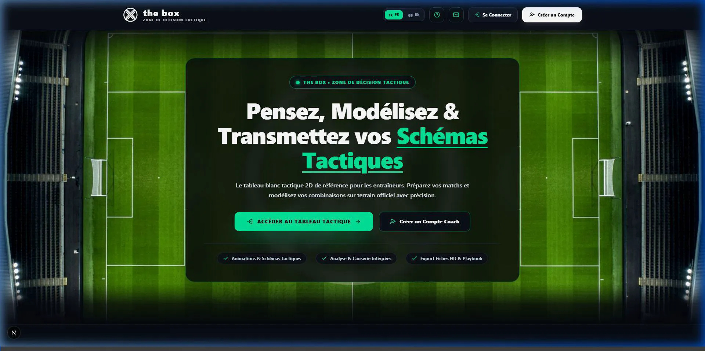
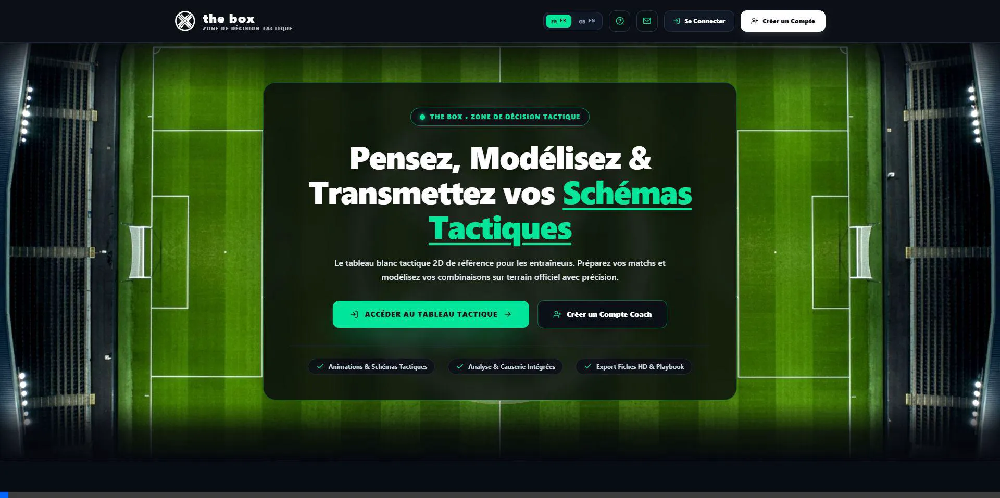
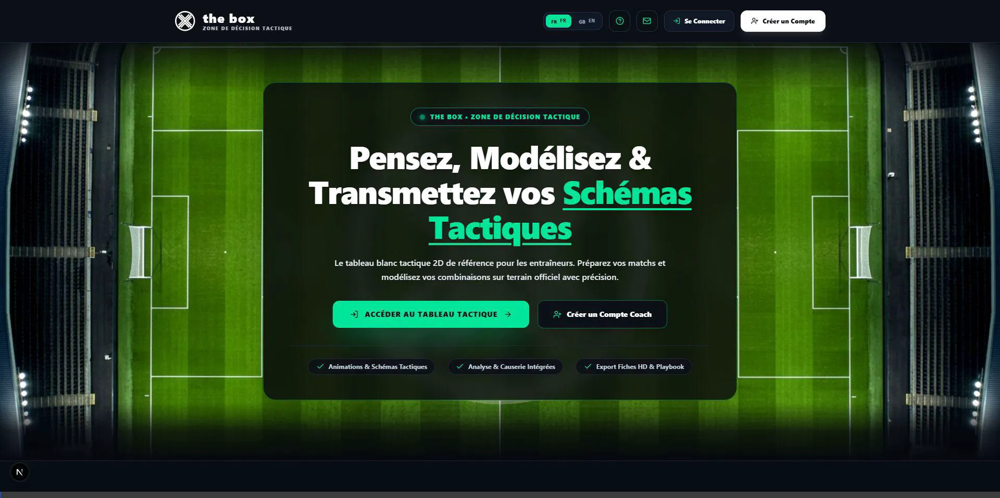

# 📖 Guide Utilisateur - TheBox (Plateforme Tactique & Coaching)

Bienvenue sur le guide d'utilisation officiel de **TheBox**. Ce document récapitule les grandes fonctionnalités de l'application afin de vous permettre de créer, animer et partager vos schémas tactiques en toute simplicité.

---

## 📑 Sommaire
1. [Vue d'ensemble & Prise en main](#1-vue-densemble--prise-en-main)
2. [Le Terrain Tactique & Les Éléments](#2-le-terrain-tactique--les-éléments)
3. [Boîte à Outils & Tracés Tactiques](#3-boîte-à-outils--tracés-tactiques)
4. [Coups de Pied Arrêtés (CPA) & Rôles Spécifiques](#4-coups-de-pied-arrêtés-cpa--rôles-spécifiques)
5. [Contrôle de Vue, Zoom & Formats de Terrain](#5-contrôle-de-vue-zoom--formats-de-terrain)
6. [Animation & Séquençage de Phases de Jeu](#6-animation--séquençage-de-phases-de-jeu)
7. [Gestion de l'Effectif & Causerie Vocale](#7-gestion-de-leffectif--causerie-vocale)
8. [Mode Live Match & Banc de Touche Connecté](#8-mode-live-match--banc-de-touche-connecté)
9. [Sauvegarde Cloud & Bibliothèque de Stratégies](#9-sauvegarde-cloud--bibliothèque-de-stratégies)
10. [Export Haute Définition & Partage](#10-export-haute-définition--partage)
11. [Raccourcis Clavier & Astuces Pro](#11-raccourcis-clavier--astuces-pro)

---

## 1. Vue d'ensemble & Prise en main

**TheBox** est un tableau blanc tactique 2D de référence conçu pour les entraîneurs, préparateurs et éducateurs sportifs. Il vous permet de modéliser vos séances, préparer vos matchs et transmettre vos plans de jeu avec clarté.

---

### 1.1 Inscription & Connexion Coach
Pour accéder au tableau tactique, deux possibilités s'offrent à vous depuis la page d'accueil :
1. **Création d'un Compte Coach** : Cliquez sur le bouton vert **« Créer un Compte Coach »** pour ouvrir le formulaire rapide.
2. **Connexion rapide** : Connectez-vous avec votre adresse Google ou vos identifiants e-mail existants.

### 📹 Capture Vidéo - Prise en Main & Navigation

*Capture vidéo animée : Inscription du profil coach, accès immédiat au tableau tactique et présentation des barres d'outils.*

**Champs du profil coach :**
* **Prénom & Nom** : Personnalisez votre profil d'entraîneur.
* **Club / Structure** : Indiquez le nom officiel de votre club (ex: *FC TheBox*).
* **Sport Principal** : Le **Football** est disponible immédiatement par défaut en configuration officielle.
* **Période d'essai offerte** : Tout nouveau compte bénéficie automatiquement d'une période d'essai pour tester l'ensemble des fonctionnalités avancées.

---

### 1.2 La Barre Supérieure (Header & Navigation)
Une fois connecté au tableau tactique, la barre supérieure concentre les commandes essentielles :

| Élément | Description & Rôle |
| :--- | :--- |
| **Identité Coach & Menu Utilisateur** | Affiche votre nom, votre statut (*Coach Principal*) et le blason de votre club. **En cliquant dessus, vous ouvrez le Menu Utilisateur** qui donne accès au Guide d'Utilisation, au profil coach, au tutoriel interactif, au changement de thème et de langue. |
| **Sport Actif** | Badge indiquant la discipline active (*Football 11*). |
| **Statut d'Abonnement** | Indique votre formule en cours (*Essai gratuit*, *Formule PRO* ou *PRO+*). Un compte à rebours vous informe des jours restants. |
| **🎓 Tuto Coach** | Bouton interactif permettant de relancer à tout moment le tutoriel guidé en 6 étapes sur le terrain. |
| **Langue & Aide** | Bascule rapide entre Français (**FR**) et Anglais (**EN**), et accès direct à la FAQ et au support. |

> 📌 **Accès au Guide Utilisateur dans l'application :**  
> Cliquez sur votre **Profil Coach** (en haut à droite de l'écran) pour dérouler le **Menu Utilisateur**. Vous y trouverez l'entrée **Guide d'Utilisation** pour consulter à tout moment l'aide détaillée et les astuces de jeu sans quitter votre tableau tactique.

---

### 1.3 Installation sur Mobile & Tablette (PWA)
TheBox est une **Progressive Web App (PWA)** entièrement optimisée pour le bord du terrain :
* **Sur iPad / iPhone (Safari)** : Appuyez sur l'icône de partage ⎋ puis sur **« Sur l'écran d'accueil »**.
* **Sur Android (Chrome)** : Appuyez sur le menu (⋮) puis sur **« Installer l'application »**.
* **Sur PC / Mac (Chrome / Edge)** : Cliquez sur le bouton **« Installer l'application »** disponible directement dans la barre d'outils.

L'application s'ouvre alors en mode plein écran sans barre d'adresse de navigateur, prête pour vos causeries de vestiaire et séances sur le terrain.

---

## 2. Le Terrain Tactique & Les Éléments

Le terrain central vous permet de positionner et manipuler tous les acteurs d'une séance ou d'un match.

### 📹 Capture Vidéo - Manipulation des Joueurs & Ballon

*Capture vidéo animée : Positionnement des titulaires, glisser-déposer sur la pelouse et placement du ballon.*

### Les Pions disponibles :
* **Équipe A (Domicile / Vos joueurs)** : Pions personnalisables avec numéro, nom, poste et couleur.
* **Équipe B (Adversaires)** : Pions distincts pour simuler le bloc ou le pressing adverse.
* **Ballon de match** : Positionnable à la main sur n'importe quel point du terrain.

### Actions sur un joueur :
* **Déplacement** : Glisser-déposer fluide à la souris ou au doigt sur écran tactile.
* **Personnalisation (Double-clic)** : Modifiez le nom, le numéro, la photo ou le poste du joueur.
* **État de forme & discipline** : Indiquez les statuts (En forme, Fatigué, Blessé, Averti 🟨, Expulsé 🟥).

---

## 3. Boîte à Outils & Tracés Tactiques

La barre d'outils latérale gauche met à votre disposition l'ensemble des tracés conventionnels du football et des sports collectifs :

### 📹 Capture Vidéo - Tracés & Outils de Schématisation

*Capture vidéo animée : Utilisation des flèches de course, passes en pointillés, courbes, dessin libre et zones géométriques.*

| Outil | Icône | Utilisation tactique |
| :--- | :--- | :--- |
| **Flèche de course** | ↗️ | Déplacement d'un joueur sans ballon (appel en profondeur, dédoublement). |
| **Flèche de passe** | ➔ (pointillés) | Transmission au sol ou passe lobée. |
| **Course incurvée** | ⤴️ | Appel en arc de cercle pour contourner la ligne de hors-jeu. |
| **Dessin libre (Crayon)** | ✏️ | Tracé spontané ou schématisation rapide à main levée. |
| **Formes géométriques** | ⭕ / ⬛ | Zones de pressing, cadrage du porteur, zones de surnombre. |
| **Gomme & Annulation** | ⌫ / ↺ | Effacement ciblé d'un tracé ou annulation du dernier geste (`Ctrl + Z`). |
| **Remise à zéro (RAZ)** | 🗑️ | Efface tous les tracés en un clic sans déplacer les joueurs. |

---

## 4. Coups de Pied Arrêtés (CPA) & Rôles Spécifiques

TheBox intègre un module dédié à la désignation des spécialistes sur phases arrêtées :

### 📹 Capture Vidéo - Spécialistes & Rôles CPA

*Capture vidéo animée : Désignation des tireurs de corners, penalties, coups francs et capitaine.*

* 👑 **Capitaine d'équipe**
* ⚽ **Tireur de Penalty (11 mètres)**
* ⚡ **Coup Franc Direct** (axe des 20-25m)
* ↪️ **Coup Franc Excentré Gauche & Droit**
* 🚩 **Corner Gauche & Corner Droit**

> 💡 *Astuce : Ces désignations apparaissent clairement dans vos fiches de match et vos exports pour les vestiaires.*

---

## 5. Contrôle de Vue, Zoom & Formats de Terrain

Adaptez l'affichage du terrain selon la phase tactique travaillée :

### 📹 Capture Vidéo - Changement de Vue & Plein Écran

*Capture vidéo animée : Bascule terrain complet / demi-terrain offensif et activation du mode plein écran vestiaire.*

* **Vue Terrain Complet** : Idéal pour travailler les blocs d'équipe (bloc haut, bloc médian, bloc bas) et les relances de 6 mètres.
* **Vue Demi-Terrain (Half-Pitch)** : Zoom automatique sur la zone offensive ou défensive pour préparer les corners, combinaisons d'attaques placées ou sorties de balle.
* **Zoom & Échelle des Joueurs** : Ajustez la taille des pions selon la résolution de votre écran.
* **Mode Plein Écran (⛶)** : Supprime les barres de menus pour projeter la causerie sur grand écran ou vidéo-projecteur de vestiaire.

---

## 6. Animation & Séquençage de Phases de Jeu

Créez des animations multi-étapes pour expliquer le déroulement d'une action :

### 📹 Capture Vidéo - Séquençage & Moteur d'Animation

*Capture vidéo animée : Création de phases de jeu pas-à-pas et lecture fluide des trajectoires des joueurs.*

1. **Étape 1 (Départ)** : Placez les joueurs dans leur position initiale.
2. **Ajout d'une étape (+)** : Déplacez les joueurs vers leur point de chute (passe, appel).
3. **Lecture (▶ Play / Pause)** : TheBox anime la trajectoire fluide des joueurs et du ballon d'une position à l'autre.
4. **Vitesse réglable** : Ralentissez la vitesse pour analyser la synchronisation des courses.

---

## 7. Gestion de l'Effectif & Causerie Vocale

Le panneau latéral droit est votre carnet de préparation tactique d'avant-match :

### 📹 Capture Vidéo - Effectif, Causerie & Notes

*Capture vidéo animée : Saisie des compositions, organisation du banc et enregistreur vocal de causerie.*

* 📋 **Feuille de match & Compositions** :
  * Sélection des 11 titulaires et de la liste des remplaçants.
  * Répartition des rôles et organisation du banc de touche.
* 🎙️ **Enregistreur vocal de causerie** :
  * Enregistrez vos consignes orales directement rattachées au schéma tactique (explication d'une sortie de balle, consignes individuelles par poste).
  * Les joueurs et le staff peuvent réécouter la causerie directement depuis le lien partagé.
* 📝 **Bloc-notes tactique d'avant-match** :
  * Consignes collectives (ex: *"Déclencher le pressing dès la passe au latéral"*).
  * Observations sur l'adversaire (points forts, faiblesses, joueurs clés).

---

## 8. Mode Live Match & Banc de Touche Connecté

Le **Mode Live Match** transforme votre tablette ou ordinateur en véritable **banc de touche connecté** pendant la rencontre pour piloter et consigner le match en temps réel.

### 📹 Capture Vidéo - Banc Connecté & Mode Live Match

*Capture vidéo animée : Lancement du chronomètre officiel, saisie instantanée des buts, cartons et remplacements.*

### Fonctionnalités du Mode Live :
* ⏱️ **Chronomètre officiel & Contrôle du temps** :
  * Boutons **START / PAUSE / RESET** pour lancer ou figer le chronomètre officiel de match.
  * Sélecteur de périodes en 1 clic : **1MT** (1ère mi-temps), **PAUSE** (mi-temps), **2MT** (2ème mi-temps) et **FIN**.
* 📊 **Tableau d'affichage & Score en direct** :
  * Saisie instantanée des buts pour l'équipe à domicile et l'équipe adverse.
* ⚽ **Enregistrement des Buts & Passes décisives** :
  * Attribution du but au joueur concerné.
  * Sélection du passeur décisif pour enrichir les statistiques d'équipe.
* 🟨 / 🟥 **Gestion de la discipline (Cartons jaunes & rouges)** :
  * Attribution d'un avertissement (🟨) ou d'une expulsion directe (🟥).
  * Mise à jour visuelle immédiate du statut du joueur sur le terrain (gestion automatique du cumul des cartons et exclusions).
* 🔄 **Remplacements en direct** :
  * Réalisation des changements tactiques ou des sorties sur blessure en direct.
  * Horodatage automatique à la minute précise du match avec indication du joueur sortant et entrant.
* 📜 **Fil d'événements du match (Live Feed)** :
  * Historique chronologique et détaillé de tous les faits de jeu (ex: `⚽ Dupont (Passe : Martin) 2MT 58'`).
  * Possibilité de supprimer ou corriger un événement en cas d'erreur de saisie.
* 🏁 **Clôture officielle de la rencontre (Terminer le match)** :
  * Bouton dédié pour figer le résultat, archiver les statistiques du match et enregistrer le bilan dans l'historique du club.

---

## 9. Sauvegarde Cloud & Bibliothèque de Stratégies

Vos créations ne sont jamais perdues :

### 📹 Capture Vidéo - Bibliothèque & Sauvegarde Cloud

*Capture vidéo animée : Sauvegarde sécurisée sur le cloud et réutilisation instantanée des fiches tactiques.*

* **Sauvegarde Cloud (Firebase)** : Enregistrez vos exercices et compositions sur votre compte sécurisé.
* **Bibliothèque de schémas (Strategy Library)** :
  * Classement par catégorie : *Phase Offensive, Bloc Défensif, Coups de pied arrêtés, Séances d'entraînement*.
  * Recherche par mot-clé et chargement instantané sur le terrain.

---

## 10. Export Haute Définition & Partage

Communiquez vos plans de jeu facilement à vos joueurs et à votre staff :

### 📹 Capture Vidéo - Export Image HD & Partage

*Capture vidéo animée : Génération de l'image PNG haute résolution et partage immédiat pour les vestiaires.*

* **Export Image PNG HD** : Télécharge une image nette et propre du terrain avec vos tracés et le logo de votre club.
* **Partage par Messagerie / WhatsApp** : Génère un lien ou une image optimisée pour diffusion rapide dans les groupes d'équipe.
* **Envoi d'email automatique** : Envoyez le schéma directement sur l'adresse email des joueurs ou dirigeants depuis la plateforme.

---

## 11. Raccourcis Clavier & Astuces Pro

### 📹 Capture Vidéo - Raccourcis Clavier & Fluidité Pro

*Capture vidéo animée : Démonstration des raccourcis rapides pour manipuler le tableau sans interruption.*

| Action | Raccourci |
| :--- | :--- |
| **Annuler le dernier tracé** | `Ctrl + Z` (ou `Cmd + Z` sur Mac) |
| **Rétablir un tracé** | `Ctrl + Y` (ou `Cmd + Shift + Z`) |
| **Plein écran** | `F` ou bouton ⛶ |
| **Passer au demi-terrain** | Bouton vue terrain |
| **Désélectionner un outil** | Échap (`Escape`) |

---

*Document généré pour TheBox. Vous pouvez éditer et enrichir ce fichier au fur et à mesure des évolutions de l'application.*
